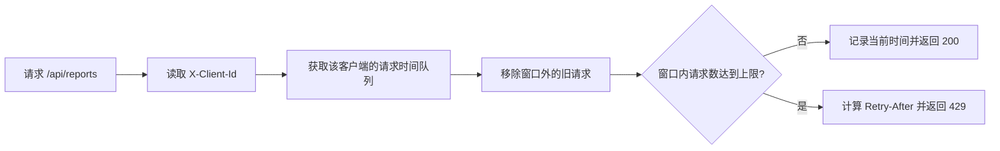

# 接口限流：逐客户端滑动窗口

## 场景

某个查询接口的容量有限，希望限制单个客户端在任意连续时间窗口内的请求次数。

常见追问：

- 固定窗口、滑动窗口、令牌桶和漏桶有什么区别？
- 多实例部署后，计数放在哪里？
- 热点客户端很多时，内存会不会无限增长？
- 被限流后客户端应该如何重试？

## Demo 边界

本 Demo 实现：

- 按 `X-Client-Id` 隔离计数。
- 滑动窗口日志算法，窗口内请求数不超过配置上限。
- 返回标准 HTTP `429` 和 `Retry-After`。
- 返回 `X-RateLimit-Limit`、`X-RateLimit-Remaining`。
- 使用虚拟时钟测试窗口边界，并验证并发请求不会突破上限。

本 Demo 不实现：

- 多实例共享计数。
- 限流规则动态下发。
- 按接口、IP、用户等级等维度组合限流。
- 热点 Key 过期清理。
- Redis 故障时的降级策略。

## 核心流程



每个客户端对应一个时间队列。允许请求时记录当前时间；拒绝请求时不写入队列，因此被拒绝的流量不会进一步占满窗口。

## 启动

在仓库根目录执行：

```powershell
mvn -pl demos/rate-limit spring-boot:run
```

服务监听 `http://localhost:8081`。

## 演示

默认规则是 10 秒内最多 3 次请求：

```powershell
1..4 | ForEach-Object {
  curl.exe -i -s -H "X-Client-Id: demo-user" http://localhost:8081/api/reports
  ""
}
```

预期结果：

- 第 1 至 3 次返回 `200 OK`，剩余次数分别为 `2`、`1`、`0`。
- 第 4 次返回 `429 Too Many Requests`，带 `Retry-After`。
- 等待窗口结束后再次请求，会重新返回 `200 OK`。

更换 `X-Client-Id` 会得到独立额度：

```powershell
curl.exe -i -s -H "X-Client-Id: another-user" http://localhost:8081/api/reports
```

## 测试

```powershell
mvn -pl demos/rate-limit test
```

测试覆盖：

- 达到上限后拒绝。
- 最旧请求离开窗口后恢复。
- 客户端之间相互隔离。
- 40 个并发请求仍只有 5 个通过。
- HTTP 响应头、`429` 和响应体字段。

## 生产化差距

- **共享状态**：用 Redis Lua 脚本或专用限流服务维护多实例共享计数；本地内存只能做单机或分层限流。
- **原子性**：生产实现需要确保判断与写入的原子性。Redis 中通常把清理、计数和写入放在同一段 Lua 中。
- **状态回收**：需要为客户端 Key 设置空闲过期，避免无限增长；也可使用 Caffeine 等带容量和过期策略的本地缓存。
- **时钟**：当前实现依赖应用时钟，生产方案应明确时钟同步假设，或使用 Redis 服务端时间。
- **算法选择**：滑动窗口日志精确但内存开销高；高吞吐场景常用令牌桶或滑动窗口计数，并接受一定误差。
- **降级策略**：Redis 不可用时，应根据业务选择放行、拒绝或回退到本地限流，并配套监控告警。
- **观测**：应记录通过数、拒绝数、规则命中、Redis 延迟和客户端维度 Top N，避免只看到 HTTP 429 数量。

## 延伸练习

1. 增加令牌桶算法并通过同一组测试。
2. 把时间队列迁移到 Redis，使用 Lua 保持原子性。
3. 增加“突发额度 + 平均速率”双参数规则。
4. 为被限制的客户端设计带抖动的重试策略。

